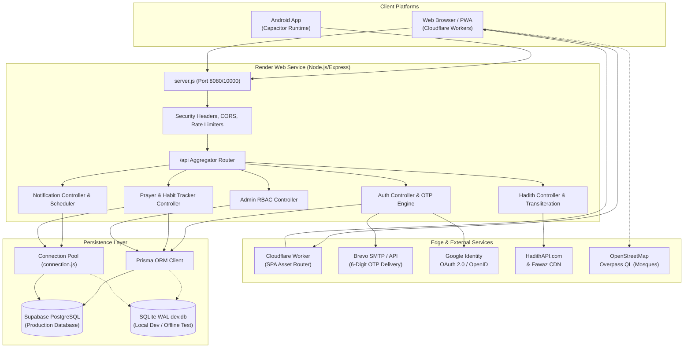
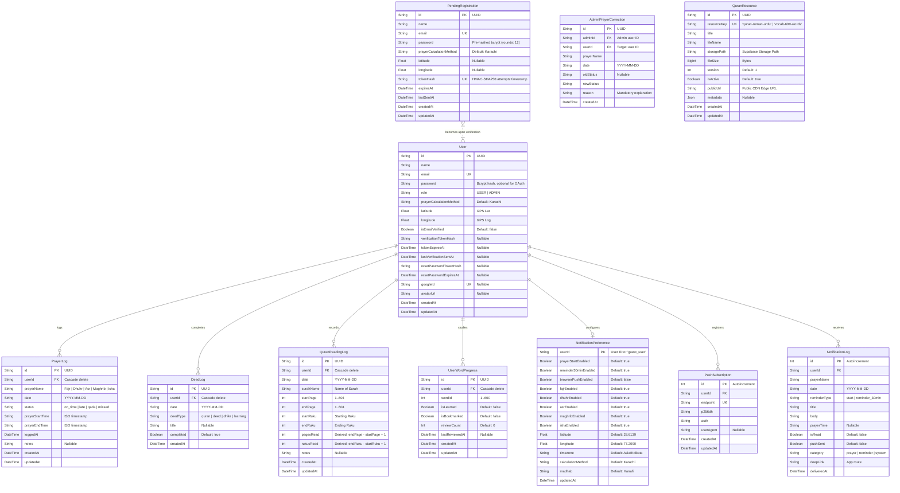
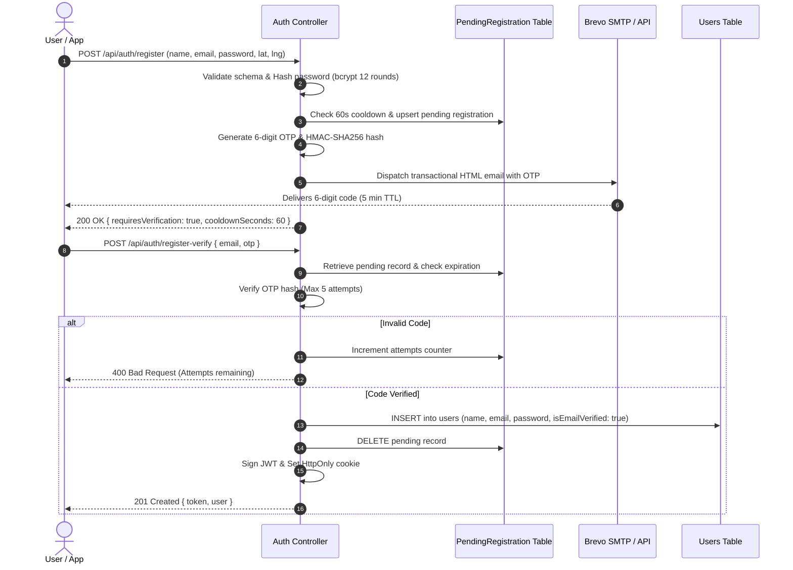

# AGENTS.md — Centralized AI Context & Engineering Guide for Salah Companion

> **Notice to AI Coding Agents:**
> This document is the single source of truth for the **Salah Companion** project.
> **Always read this file before inspecting or modifying code.**
> Do not scan the entire codebase unnecessarily. Treat this document as the primary architectural reference.
> Inspect only the specific files relevant to your assigned task.
> Never invent endpoints, database columns, or dependencies not documented here.
> If you make structural, architectural, API, or database changes, you **must** update this file to keep it synchronized with the actual implementation.

---

## Table of Contents

1. [Project Overview](#1-project-overview)
2. [Project Goals and Features](#2-project-goals-and-features)
3. [Current Technology Stack and Versions](#3-current-technology-stack-and-versions)
4. [Complete Project Architecture](#4-complete-project-architecture)
5. [Frontend Structure](#5-frontend-structure)
6. [Backend Structure](#6-backend-structure)
7. [Database Architecture and Relationships](#7-database-architecture-and-relationships)
8. [Authentication and Authorization Flow](#8-authentication-and-authorization-flow)
9. [Google OAuth Implementation](#9-google-oauth-implementation)
10. [Email OTP Verification Flow](#10-email-otp-verification-flow)
11. [API Documentation](#11-api-documentation)
12. [Core Business Logic and Rules](#12-core-business-logic-and-rules)
13. [Salah Tracking Rules](#13-salah-tracking-rules)
14. [Quran and Hadith Integration](#14-quran-and-hadith-integration)
15. [Third-Party APIs and Services](#15-third-party-apis-and-services)
16. [Environment Variables Reference](#16-environment-variables-reference)
17. [UI/UX Design System](#17-uiux-design-system)
18. [Security Implementation](#18-security-implementation)
19. [Error Handling and Validation](#19-error-handling-and-validation)
20. [Deployment Architecture](#20-deployment-architecture)
21. [Development and Build Commands](#21-development-and-build-commands)
22. [Testing Strategy](#22-testing-strategy)
23. [Implemented Features](#23-implemented-features)
24. [Partially Implemented Features](#24-partially-implemented-features)
25. [Pending Features and Known Issues](#25-pending-features-and-known-issues)
26. [Important Files and Their Responsibilities](#26-important-files-and-their-responsibilities)
27. [Coding Standards and Development Conventions](#27-coding-standards-and-development-conventions)
28. [AI Agent Instructions and Project Rules](#28-ai-agent-instructions-and-project-rules)
29. [Future Roadmap](#29-future-roadmap)

---

## 1. Project Overview

**Salah Companion** is a full-stack, cross-platform Islamic spiritual companion and prayer tracking application. It is engineered as a modern Progressive Web App (PWA) with native Android capabilities powered by Capacitor, a resilient Node.js Express REST API backend, and Supabase PostgreSQL persistence (with local SQLite fallback).

The platform serves Muslims worldwide—with dedicated localization for Indian cities and global coordinates—by providing astronomical prayer times, an authoritative same-day Salah habit tracker, contextual status-based Hadiths, official Hadith collection learning (Bukhari, Muslim, Tirmidhi, Abu Dawood, Ibn Majah), an offline Quran PDF reader with 600 verified vocabulary flashcards, a geodesic Qibla compass, an interactive Mosque finder, Islamic calendar calculations, and automated multi-channel prayer alarms and reminders.

---

## 2. Project Goals and Features

### Primary Goals
- **Disciplined Habit Formation:** Enforce authentic Islamic prayer timings without allowing artificial manipulation of historical or future prayers.
- **Offline First Resilience:** Enable core prayer schedules, Quran reading, vocabulary study, and Qibla navigation to function seamlessly without continuous internet connectivity.
- **Cross-Platform Parity:** Deliver a single unified codebase that compiles to a responsive Web application (hosted on Cloudflare Workers), an installable PWA, and a native Android APK/AAB package via Capacitor.
- **Enterprise-Grade Verification:** Enforce zero unverified signups via 6-digit Brevo OTP email delivery, complete with rate limiting, cooldown protection, and secure HttpOnly cookie / Bearer JWT authorization.

### Core Features
- **Astronomical Prayer Timetables:** High-precision offline calculations via the `adhan` library supporting Karachi, MWL, Egyptian, Makkah, ISNA, and custom methods across Hanafi and Shafi'i madhabs.
- **Daily Salah Habit Tracker:** 5 daily slots (Fajr, Dhuhr/Jumu'ah, Asr, Maghrib, Isha) tracking `on_time`, `late`, `qada`, and `missed` statuses with real-time prime-window evaluation.
- **Friday Jumu'ah Unification:** Automatic mapping where Friday midday represents either Dhuhr or Jumu'ah, preventing slot duplication while supporting custom congregation times.
- **Dual-Source Hadith Architecture:**
  1. *Status-Tailored Hadiths:* Curated authentic Hadiths delivered immediately upon prayer logging to encourage punctuality or repentance.
  2. *Official HadithAPI & CDN Module:* Paginated study of classical books with Arabic, English, Urdu, and auto-generated Roman Urdu transliteration.
- **Offline Quran Reader & 600-Word Vocabulary:** Large-file IndexedDB chunked streaming for the complete 138 MB Roman Urdu/Hindi Quran PDF, alongside 600 essential Quranic vocabulary words with categorization, bookmarks, and learned tracking.
- **Sensor-Driven Qibla Compass:** Great Circle Azimuth geodesic calculations to the Holy Kaaba in Makkah (21.422487° N, 39.826206° E) with Exponential Moving Average (EMA) heading smoothing and alignment haptics.
- **Nearby Mosque Finder:** Real-time OpenStreetMap Overpass QL geospatial queries to discover active Masjids within configurable radii (2 km, 5 km, 10 km) with direction routing.
- **Comprehensive Islamic Calendar:** Hijri calendar converter, White Days (*Ayyam al-Beed* 13th–15th) highlighting, major Islamic holidays, and fasting schedules.
- **Production Notification Engine:** Multi-tier delivery featuring Web Push (VAPID) and Capacitor Native Local Notifications with start-time alarms and 30-minute expiration alerts.
- **Role-Based Admin Dashboard:** User directory management, role promotion/demotion (guarded by permanent admin protection), audit overview metrics, and system-wide broadcast notifications.

---

## 3. Current Technology Stack and Versions

### Frontend (Client)
| Technology | Version | Purpose |
| :--- | :--- | :--- |
| **React** | `^19.2.8` | Core UI rendering engine |
| **React DOM** | `^19.2.8` | DOM bindings for React 19 |
| **TypeScript** | `~6.0.2` | Strong static typing across application |
| **Vite** | `^8.3.0` | Next-generation frontend build tool and dev server |
| **Tailwind CSS** | `^4.3.3` | Modern CSS-first utility styling framework (`@tailwindcss/vite`) |
| **React Router DOM** | `^7.18.4` | Client-side routing with route guarding |
| **@tanstack/react-query** | `^5.104.1` | Server state management, caching, and background synchronization |
| **Adhan (JS)** | `^4.4.6` | Astronomical prayer calculation engine (offline client-side) |
| **Lucide React** | `^1.52.0` | UI vector icons |
| **@react-oauth/google** | `^0.13.5` | Google Identity Services and One Tap integration |
| **Vite Plugin PWA** | `^2.0.0` | Workbox service worker generation and web manifest handling |
| **Capacitor Core / CLI** | `^8.6.0` | Hybrid native runtime bridge for mobile deployments |
| **Capacitor Android** | `^8.6.0` | Android platform binding and Gradle project harness |
| **Capacitor Plugins** | `App 8.1`, `Browser 8.0`, `Geo 8.2`, `Haptics 8.0`, `LocalNotifications 8.3`, `StatusBar 8.0` | Native hardware hooks (GPS, notifications, haptics, status bar) |
| **Wrangler** | `^4.149.0` | Cloudflare Workers deployment CLI |

### Backend (Server)
| Technology | Version | Purpose |
| :--- | :--- | :--- |
| **Node.js** | `>=18.0.0` (v24 compatible) | Runtime environment (native ES Modules) |
| **Express** | `^4.21.2` | REST API HTTP framework |
| **Prisma ORM** | `^6.19.3` | Schema definition, migrations, and PostgreSQL client |
| **pg** | `^8.23.1` | Low-level PostgreSQL connection pool driver |
| **better-sqlite3** | `^11.8.1` | Zero-dependency synchronous SQLite engine for offline dev/tests |
| **@supabase/supabase-js**| `^2.117.3` | Supabase storage and auth integration |
| **Adhan (JS)** | `^4.4.6` | Authoritative server-side prayer timetable generation |
| **jsonwebtoken** | `^9.0.3` | Signed JWT session token creation and verification |
| **bcryptjs** | `^3.0.3` | Adaptive 12-round salted password hashing |
| **google-auth-library** | `^11.2.0` | OAuth2Client for server-side Google token verification |
| **Nodemailer** | `^10.1.0` | SMTP client transport for Brevo and fallback delivery |
| **Web-Push** | `^3.6.7` | VAPID-compliant Web Push payload encryption and dispatch |
| **Zod** | `^4.6.5` | Strict declarative input validation middleware |
| **Axios** | `^1.20.0` | External HTTP client for HadithAPI and CDN calls |
| **Cookie-Parser** | `^1.4.7` | Secure HttpOnly cookie parsing |
| **CORS** | `^2.8.5` | Dynamic cross-origin resource sharing policy enforcement |
| **Dotenv** | `^16.4.7` | Multi-profile environment variable loader |

---

## 4. Complete Project Architecture

The Salah Companion platform employs a decoupled client-server architecture with dual database driver resilience:



### Key Architectural Patterns
1. **Dynamic Environment Profiling:** Both frontend and backend auto-select configurations based on environment (`development` vs `production`).
2. **Dual-Tier Database Strategy:** Production uses Supabase PostgreSQL through connection poolers (PgBouncer port 6543) and direct connection (port 5432). Local development automatically diverts to `database.sqlite` / `dev.db` when Supabase is inaccessible or during automated test runs.
3. **Graceful Degradation:** The client calculates prayer times and Qibla direction offline using local astronomical math without blocking on network availability.
4. **Idempotency & Isolation:** Background schedulers and prayer logging routes enforce strict idempotency keys to eliminate double logging and notification spam.

---

## 5. Frontend Structure

Directory: `src/`

```text
src/
├── api/                    # API query clients
│   ├── hadithClient.ts     # Fawaz Ahmed CDN client with caching
│   └── hadithModuleApi.ts  # HadithAPI.com client with pagination
├── assets/                 # Static graphical assets, hero banners, SVG icons
├── components/             # React presentation and container components
│   ├── landing/            # Landing page sub-components (Hero, Features, Navbar, CTA)
│   ├── AdminRoute.tsx      # RBAC Route Guard: Requires user.role === 'ADMIN'
│   ├── AppExitModal.tsx    # Native Android double-back exit confirmation dialog
│   ├── AuthModal.tsx       # Modal wrapper for login/signup tab switching
│   ├── BilingualHadithCard.tsx # Dual Arabic/English card renderer
│   ├── BottomNav.tsx       # 5-tab mobile bottom navigation bar
│   ├── CalendarModal.tsx   # Islamic Hijri + Gregorian calendar modal
│   ├── CustomIcons.tsx     # Custom Islamic SVG icons (Kaaba, Tasbih, Moon, Crescent)
│   ├── DailyHadithSection.tsx # Dashboard daily reflection card
│   ├── DesktopSidebar.tsx  # Responsive left navigation drawer for large screens
│   ├── HadithCard.tsx      # Status-tailored Hadith display card
│   ├── HadithLearningModule.tsx # Comprehensive Hadith book study interface
│   ├── HadithModuleCard.tsx# Individual Hadith entry card with copy/share
│   ├── HadithScreen.tsx    # Dedicated Hadith tab / view
│   ├── Header.tsx          # Top app bar (city selector, notifications, profile)
│   ├── Modals.tsx          # Collection of auxiliary app dialogs
│   ├── MosqueFinderModal.tsx # OpenStreetMap nearby mosque locator
│   ├── MySalahScreen.tsx   # Comprehensive weekly Salah tracker & calendar view
│   ├── NextPrayerCard.tsx  # High-impact active prayer countdown hero card
│   ├── PrayerConfirmationModal.tsx # Validation dialog before logging completion
│   ├── ProgressScreen.tsx  # Habit streaks, completion percentages, analytics
│   ├── ProtectedRoute.tsx  # Route Guard: Redirects guests to /login
│   ├── PublicOnlyRoute.tsx # Route Guard: Redirects authenticated users to /app
│   ├── PwaInstallPrompt.tsx# A2HS (Add to Home Screen) install banner
│   ├── QiblaCompassModal.tsx # Sensor-based directional compass to Kaaba
│   ├── QuranScreen.tsx     # Offline PDF reader and 600-word vocabulary trainer
│   ├── ServerWarmupNotice.tsx # Auto-detects Render cold start and shows warmup pill
│   ├── SettingsScreen.tsx  # App configurations, calculation methods, notifications
│   ├── SignOutConfirmationModal.tsx # Explicit sign-out prompt
│   ├── StrengthenIman.tsx  # Curated lessons and inspirational articles
│   ├── TodaysDeeds.tsx     # Daily Sunnah deed checklist (6 deeds)
│   └── TodaysSalah.tsx     # Primary 5-prayer completion list on Home tab
├── context/
│   └── AuthContext.tsx     # Centralized user session, login, logout, and banner state
├── data/
│   ├── hadiths.ts          # Embedded collection of authentic status Hadiths
│   ├── quranVocabulary.ts  # Types and helper accessors for vocabulary
│   └── quranVocabulary600.json # 600 verified Quranic vocabulary entries
├── hooks/
│   ├── useExitConfirmation.ts # Hardware back-button handling on Android
│   ├── useHadithModuleQuery.ts # React Query hook for paginated Hadith collections
│   ├── useHadithQuery.ts   # React Query hook for daily and status Hadiths
│   └── useSalahNotifications.ts # Local and push notification lifecycle coordinator
├── pages/
│   ├── AdminDashboard.tsx  # Comprehensive admin portal for user & system management
│   ├── AppDashboard.tsx    # Primary authenticated application screen (5 tabs)
│   ├── LandingPage.tsx     # Marketing / landing page for guest visitors
│   ├── LoginPage.tsx       # Auth portal: Password login, OTP login, Registration
│   └── ResetPasswordPage.tsx # Password recovery form with secure token verification
├── platform/               # Hardware and OS abstraction layer
│   ├── device.ts           # Haptics, screen wake lock, vibration
│   ├── location.ts         # Geolocation abstraction (Capacitor vs HTML5)
│   ├── notifications.ts    # Notification bridge (Capacitor Local vs Web Push)
│   ├── oauth.ts            # Native browser OAuth launch helper
│   ├── platform.ts         # Runtime detection (isAndroid, isNative, isPWA, isWeb)
│   └── storage.ts          # Unified persistent key-value storage
├── services/
│   ├── backendApi.ts       # Central REST API client connecting to /api
│   └── offlineQuranService.ts # IndexedDB large-file chunk storage engine
├── types/
│   ├── hadith.ts           # Types for Fawaz CDN Hadiths
│   └── hadithModule.ts     # Types for HadithAPI.com paginated books
├── utils/
│   ├── geocoding.ts        # OpenStreetMap Nominatim reverse geocoder
│   ├── islamicCalendar.ts  # Umm al-Qura Hijri date and holy day calculation
│   ├── prayerRecords.ts    # Local storage prayer log computation & streaks
│   ├── prayerTimes.ts      # Adhan wrapper, Indian cities database, formatting
│   ├── qibla.ts            # Geodesic spherical trigonometry & heading smoothing
│   └── webPushClient.ts    # Service Worker push registration & VAPID subscription
├── App.css
├── App.tsx                 # Route configuration and global provider hierarchy
├── index.css               # Tailwind CSS imports and design tokens
├── main.tsx                # React root mount and QueryClient provider
├── types.ts                # Global domain interfaces (PrayerItem, DeedItem, etc.)
└── worker.ts               # Cloudflare Workers entry point for asset dispatch
```

---

## 6. Backend Structure

Directory: `server/src/`

```text
server/src/
├── config/
│   └── env.js              # Multi-tier .env cascade parser with defaults
├── constants/
│   └── admins.js           # Immutable permanent system administrator email registry
├── controllers/
│   ├── adminController.js  # User list, role management, system metrics, broadcasts
│   ├── authController.js   # Registration, OTP verification, password auth, Google OAuth
│   ├── fawazHadithController.js # CDN proxy for single, bilingual, and daily Hadith
│   ├── hadithApiController.js # Official HadithAPI proxy with caching & transliteration
│   ├── hadithController.js # Status-tailored Hadith delivery
│   ├── notificationController.js # Push registration, preferences, delivery logs
│   ├── prayerController.js # Adhan calculation timetable endpoint
│   ├── prayerLogController.js # Authoritative prayer CRUD, streaks, history, weekly view
│   ├── progressController.js # Aggregated progress metrics across prayers and deeds
│   └── userController.js   # User profiles, statistics, and 7-day streak algorithms
├── data/
│   └── quranVocabulary600.json # Server-side copy of vocabulary database
├── db/
│   ├── connection.js       # Low-level PostgreSQL pool & SQLite fallback query engine
│   ├── prisma.js           # PrismaClient singleton instance
│   └── schema.sql          # Raw SQLite schema definition for local testing
├── middlewares/
│   ├── authMiddleware.js   # JWT validation, role checking, verified email enforcement
│   ├── errorHandler.js     # Global uncaught exception and 404 handlers
│   └── rateLimiter.js      # Sliding-window IP and email brute-force limiters
├── routes/
│   ├── adminRoutes.js      # /api/admin/*
│   ├── authRoutes.js       # /api/auth/*
│   ├── hadithRoutes.js     # /api/hadith/* and /api/hadiths/*
│   ├── index.js            # Aggregator router and /health endpoint
│   ├── notificationRoutes.js # /api/notifications/*
│   ├── prayerLogRoutes.js  # /api/prayers/*
│   ├── prayerRoutes.js     # /api/prayers (timetable) and /api/prayer/log
│   ├── progressRoutes.js   # /api/progress/*
│   └── userRoutes.js       # /api/user/* and /api/users
├── schemas/
│   ├── authSchema.js       # Zod schemas for auth payloads
│   ├── fawazHadithSchema.js# Zod schemas for Hadith query parameters
│   └── prayerLogSchema.js  # Zod schemas for prayer completion requests
├── services/
│   ├── email/
│   │   ├── templates/      # Responsive HTML email templates
│   │   │   ├── otpEmailTemplate.js          # 6-Digit OTP verification email
│   │   │   └── resetPasswordEmailTemplate.js# Password reset email
│   │   └── brevoEmailService.js # Primary Brevo SMTP/API with fallback transport
│   ├── adminBootstrapService.js # Guarantees permanent admins exist in database
│   ├── fawazHadithService.js # External CDN fetcher with error normalization
│   ├── googleAuthService.js # Google token verification and code exchange
│   ├── hadithApiService.js  # Upstream HadithAPI client with in-memory caching
│   ├── hadithService.js     # Curated Hadith library by prayer status
│   ├── logService.js        # Legacy raw SQL prayer logging and evaluation
│   ├── notificationScheduler.js # 30-second interval scheduler for due alerts
│   ├── notificationService.js # Push payload construction and delivery tracking
│   ├── otpService.js        # Cryptographic 6-digit OTP generation and hashing
│   ├── prayerService.js     # Server Adhan calculator & timing validation engine
│   └── userService.js       # Habit summary and streak calculation algorithms
├── utils/
│   ├── cache.js             # In-memory LRU-style cache with TTL
│   ├── dateUtils.js         # IANA timezone-aware date keys (YYYY-MM-DD)
│   └── transliterateUrdu.js # Custom phonetic Urdu-to-Roman transliteration engine
└── server.js                # Express initialization, security headers, CORS, shutdown
```

---

## 7. Database Architecture and Relationships

The database is managed via Prisma schema (`server/prisma/schema.prisma`) targeting PostgreSQL in production, with equivalent tables defined in `server/prisma/schema.sqlite.prisma` and `server/src/db/schema.sql` for SQLite.



### Table Relationships & Key Constraints
1. **User → PrayerLog:** One-to-many. Unique compound constraint: `@@unique([userId, prayerName, date])`. Guarantees exactly one record per prayer per day per user.
2. **User → DeedLog:** One-to-many. Unique compound constraint: `@@unique([userId, deedType, date])`.
3. **PendingRegistration:** Isolated staging table. Users are **never** inserted into the `users` table until their email OTP is cryptographically verified. Stored token format: `<hash>:<failedAttempts>:<timestamp>`.
4. **NotificationLog:** Stores delivery history for idempotency. Unique constraint: `@@unique([userId, prayerName, date, reminderType])`. Prevents duplicate alerts within the same window.
5. **AdminPrayerCorrection:** Immutable audit log tracking every administrative change, old vs new status, target user, admin actor, timestamp, and mandatory explanation reason.

---

## 8. Authentication and Authorization Flow

### Session Management
- **Stateless JWT Tokens:** Signed using `HS256` via `config.jwtSecret`. Encodes payload `{ id, email, role }` with default 7-day expiration (`config.jwtExpiresIn`).
- **Dual Transport:**
  1. *HttpOnly Cookie:* Named `auth_token` (`SameSite=None` in production, `Secure=true`, `HttpOnly=true`).
  2. *Bearer Authorization Header:* `Authorization: Bearer <token>` automatically attached by frontend API client.
- **Client Storage:** Auth token is also mirrored in browser `localStorage` (`salah_auth_token`) for Capacitor mobile compatibility where third-party cookies may be blocked.

### Role-Based Access Control (RBAC)
- **Roles:** `'USER'` (standard) and `'ADMIN'` (system administrator).
- **Guarded Routes:**
  - `protectRoute`: Verifies token signature and checks user existence in database.
  - `requireVerifiedEmail`: Blocks unverified users from accessing prayer tracking and stats.
  - `restrictTo('ADMIN')`: Requires `req.user.role === 'ADMIN'`.
- **Permanent Administrators:**
  Hardcoded in `server/src/constants/admins.js`:
  - `mdsaifahmad78@gmail.com`
  - `mdsaiahmad78@gmail.com`
  These accounts are guaranteed to retain `ADMIN` role and verified status upon every server startup via `adminBootstrapService.js`. They cannot be demoted or deleted.

---

## 9. Google OAuth Implementation

### Architectural Flow
Salah Companion supports both Google One Tap / credential flow and full redirect OAuth 2.0 authorization:

1. **Client-Side Google Identity Services:**
   - Frontend initializes `<GoogleOAuthProvider clientId={VITE_GOOGLE_CLIENT_ID}>`.
   - On credential reception: Dispatches `POST /api/auth/google` with `{ credential }`.
2. **Server-Side Authorization Code Redirect (Mobile & Web fallback):**
   - User navigates to `GET /api/auth/google?redirect_to=<frontend_url>`.
   - Server generates cryptographic CSRF state, stores it in cookie, and redirects user to Google's consent screen with scopes `openid`, `email`, `profile`.
   - Google redirects to `GET /api/auth/google/callback?code=...&state=...`.
   - Server exchanges authorization code for tokens, verifies profile using Google Auth Library, and finds or upserts the `User` record with `isEmailVerified: true` and `googleId`.
   - Server issues JWT, sets HttpOnly cookie, and redirects user to frontend with `?token=<jwt>` (or custom Android scheme `com.salahcompanion.app://`).

---

## 10. Email OTP Verification Flow

Salah Companion strictly enforces an Amazon/Flipkart-style 6-digit OTP verification model. Account creation occurs **only** after email verification.



### Rate Limiting & Cooldown Protection
- **Registration IP Limit:** 10 requests per 15 minutes per IP (`registerIpRateLimiter`).
- **Resend Cooldown:** 60-second mandatory cooldown enforced at database level (`lastSentAt`). Attempting to resend earlier returns HTTP 429 (`RESEND_COOLDOWN`).
- **OTP Expiration:** Exactly 5 minutes from dispatch.
- **Maximum Attempts:** 5 attempts. Exceeding 5 failed attempts deletes the pending record, forcing the user to sign up again (`OTP_MAX_ATTEMPTS_EXCEEDED`).

---

## 11. API Documentation

Base URL: `http://localhost:8080/api` (Dev) | `https://salah-companion-z3i4.onrender.com/api` (Prod)

### Health Check
- `GET /health` (or `/api/health`): Returns database connectivity, provider (`postgresql` or `sqlite`), server time, and latency.

### Authentication Endpoints (`/api/auth`)
| Method | Path | Auth Required | Description |
| :--- | :--- | :--- | :--- |
| `POST` | `/api/auth/register` | No | Submit registration details. Sends 6-digit OTP via Brevo. |
| `POST` | `/api/auth/register-verify`| No | Verify 6-digit OTP and create user account. |
| `POST` | `/api/auth/register-resend`| No | Resend registration OTP (subject to 60s cooldown). |
| `POST` | `/api/auth/login` | No | Authenticate with email and password. Returns JWT. |
| `POST` | `/api/auth/forgot-password`| No | Request password recovery email with reset token. |
| `POST` | `/api/auth/reset-password` | No | Reset password using valid recovery token. |
| `POST` | `/api/auth/send-otp` | No | Request standalone 6-digit OTP for login. |
| `POST` | `/api/auth/verify-otp` | No | Authenticate with 6-digit OTP. |
| `POST` | `/api/auth/resend-otp` | No | Resend standalone OTP. |
| `GET` | `/api/auth/google` | No | Initiate Google OAuth 2.0 redirect flow. |
| `GET` | `/api/auth/google/callback`| No | Google OAuth 2.0 callback destination. |
| `POST` | `/api/auth/google` | No | Google One Tap credential authentication. |
| `POST` | `/api/auth/logout` | No | Clears `auth_token` HttpOnly cookie. |
| `GET` | `/api/auth/me` | Bearer/Cookie | Fetch current authenticated user profile. |
| `PATCH`| `/api/auth/profile` | Bearer/Cookie | Update user name, calculation method, coordinates. |
| `POST` | `/api/auth/set-password` | Bearer/Cookie | Set or update password for OAuth or existing accounts. |

### Prayer & Habit Tracking Endpoints (`/api/prayers`)
| Method | Path | Auth Required | Description |
| :--- | :--- | :--- | :--- |
| `GET` | `/api/prayers` | No | Calculate astronomical prayer timetable for coordinates. Query params: `lat`, `lng`, `method`, `madhab`, `date`. |
| `POST` | `/api/prayers/log` | Verified User | Upsert prayer log for today. Enforces strict start-time validation. Returns tailored Hadith. |
| `GET` | `/api/prayers/today` | Verified User | Fetch today's prayer logs with completion counts out of 5. |
| `GET` | `/api/prayers/weekly` | Verified User | Structured 7-day overview (Monday–Sunday) with analytics. |
| `GET` | `/api/prayers/history` | Verified User | Completion history grouped by date. Query param: `days` (default 7). |
| `GET` | `/api/prayers/analytics`| Verified User | Breakdown percentages, on-time rate, and active streaks. |
| `PATCH`| `/api/prayers/log/:id` | Verified User | Update existing prayer status or personal notes. |
| `DELETE`| `/api/prayers/log/:id` | Verified User | Undo/delete a prayer logged today. Historical records are read-only. |

### Progress Summary (`/api/progress`)
| Method | Path | Auth Required | Description |
| :--- | :--- | :--- | :--- |
| `GET` | `/api/progress/summary` | Verified User | Aggregated metrics for Progress Screen: weekly completion %, streaks, deed stats. |

### Hadith Endpoints (`/api/hadith` & `/api/hadiths`)
| Method | Path | Auth Required | Description |
| :--- | :--- | :--- | :--- |
| `GET` | `/api/hadith` | No | Fetch curated Hadith by status. Query param: `status` (`on_time`, `late`, `missed`). |
| `GET` | `/api/hadiths` | No | Official HadithAPI learning module. Query params: `book`, `hadithNumber`, `page`, `paginate`. |
| `GET` | `/api/hadiths/books` | No | Verified books metadata (Bukhari, Muslim, Tirmidhi, etc.). |
| `GET` | `/api/hadith/single` | No | Fawaz CDN single Hadith. Query params: `edition`, `hadithNumber`. |
| `GET` | `/api/hadith/bilingual`| No | Fawaz CDN bilingual (Arabic + English) Hadith. |
| `GET` | `/api/hadith/daily` | No | Daily reflection Hadith based on day-of-year seed. |
| `GET` | `/api/hadith/cache/metrics` | No | In-memory cache hit rate and size metrics. |

### Notification Endpoints (`/api/notifications`)
| Method | Path | Auth Required | Description |
| :--- | :--- | :--- | :--- |
| `GET` | `/api/notifications/vapid-public-key` | No | Fetch VAPID public key for Web Push registration. |
| `GET` | `/api/notifications/preferences` | Optional | Retrieve notification preferences for user or guest. |
| `PUT` | `/api/notifications/preferences` | Optional | Update notification preferences. |
| `POST` | `/api/notifications/subscribe` | Optional | Register Web Push browser subscription. |
| `POST` | `/api/notifications/unsubscribe` | Optional | Remove Web Push subscription. |
| `GET` | `/api/notifications/history` | Optional | List delivered notification history with optional category filtering (`prayer`, `reminder`, `system`). |
| `PATCH`| `/api/notifications/:id/read` | Optional | Mark specific notification as read. |
| `POST` | `/api/notifications/mark-all-read` | Optional | Mark all user notifications as read. |
| `DELETE`| `/api/notifications/:id` | Optional | Delete specific notification from history. |
| `DELETE`| `/api/notifications` | Optional | Clear all notifications for user. |
| `POST` | `/api/notifications/test` | Optional | Dispatch immediate test notification. |

### Progress Endpoints (`/api/progress`)
| Method | Path | Auth Required | Description |
| :--- | :--- | :--- | :--- |
| `GET` | `/api/progress/summary` | User Token | Multi-period analytics (`period=daily\|weekly\|monthly\|yearly\|custom`), real status counts, streaks, 5-prayer breakdowns, completion trends, and period comparison. |

### Admin Endpoints (`/api/admin`)
| Method | Path | Auth Required | Description |
| :--- | :--- | :--- | :--- |
| `GET` | `/api/admin/overview` | Admin Only | System metrics: total users, verified users, today's prayer logs, breakdown. |
| `GET` | `/api/admin/users` | Admin Only | Paginated user management table with role and verification filters. |
| `PATCH`| `/api/admin/users/:id/role` | Admin Only | Promote or demote user (`USER` vs `ADMIN`). Permanent admins protected. |
| `DELETE`| `/api/admin/users/:id` | Admin Only | Delete user account and associated logs. Permanent admins protected. |
| `POST` | `/api/admin/broadcast` | Admin Only | Dispatch broadcast notification to all registered Web Push subscribers. |
| `GET` | `/api/admin/prayers` | Admin Only | Search and filter user prayer logs by user, prayer, status, and date range. |
| `POST` | `/api/admin/prayers/correct` | Admin Only | Correct or delete a prayer record for any user with mandatory reason & audit logging. |
| `GET` | `/api/admin/prayers/corrections` | Admin Only | Paginated audit trail of all administrative corrections (`admin_prayer_corrections`). |
| `GET` | `/api/admin/analytics/salah` | Admin Only | Aggregated KPIs: completion rates, quality breakdown, notification delivery rates, recent corrections. |

---

## 12. Core Business Logic and Rules

### Date & Timezone Integrity
1. **IANA Timezone Resolution:** The application resolves local calendar dates using the user's specific IANA timezone (e.g. `Asia/Kolkata`), transmitted via the `x-timezone` header or user preferences.
2. **Date Key Normalization:** All dates are stored as ISO calendar strings (`YYYY-MM-DD`). Never rely on UTC slicing for user calendar boundaries.

---

## 13. Salah Tracking Rules

### Rule 1: No Logging Before Prayer Start Time
A user **must not** be able to mark a prayer as completed before that prayer's valid astronomical time window begins.
- If a user attempts to log a prayer before its start time, the server rejects the request with **HTTP 409 Conflict** and code `PRAYER_TIME_NOT_STARTED`.
- The response returns `availableAt` ISO timestamp and human-readable time so the UI can inform the user when logging will unlock.

### Rule 2: Active-Day Completion Grace
Users can mark, correct, or undo any of their 5 daily prayers at any time during the **current local calendar day**, even after the individual prayer time window has passed.
- If logged after the prayer window expires, the status is evaluated as `late` or `missed`, but logging remains permitted throughout today.

### Rule 3: Past Days are Strictly Read-Only
Salah completion is permitted **strictly for today's local calendar date**.
- Past dates (`targetDate < todayStr`): Strictly read-only. Attempts to log or delete return **HTTP 409 Conflict** with code `PRAYER_DATE_NOT_TODAY`.
- Future dates (`targetDate > todayStr`): Strictly read-only.

### Rule 4: Prime-Window Status Evaluation
- **`on_time`:** Logged within the first 35 minutes of prayer start time (`config.primeWindowMinutes`).
- **`late`:** Logged after the 35-minute prime window but before the prayer end time.
- **`missed`:** Logged after the prayer end time has passed.
- **`qada`:** Explicit make-up status.

### Rule 5: Friday Jumu'ah Unification
- On Fridays, the midday slot represents either **Dhuhr** or **Jumu'ah**.
- A user cannot record both Dhuhr and Jumu'ah as separate slots on Friday.
- Logging Jumu'ah updates the midday slot to maintain exactly 5 prayer slots per day.
- Custom congregation times (e.g. `13:15` or `13:30`) are supported via `jumuahTime`.

### Rule 6: Idempotent Logging & Duplicate Prevention
- Repeated identical submissions return **HTTP 200 OK** with the existing log.
- Attempting to mark an already completed prayer again without an explicit `isCorrection: true` flag returns **HTTP 409 Conflict** (`PRAYER_ALREADY_COMPLETED`).

### Rule 7: Automated Overdue Missed Salah & Qada Recovery Engine
- **Automated Lifecycle Transitions:**
  - `PENDING` $\to$ `COMPLETED` (`on_time`, `late`) upon user logging.
  - `PENDING` $\to$ `MISSED` automatically once the astronomical deadline for that prayer expires.
  - `MISSED` $\to$ `QADA` upon user make-up completion via `POST /api/prayers/qada`.
- **Astronomical Deadlines:**
  - Fajr deadline: Sunrise (`times.sunrise`).
  - Dhuhr deadline: Asr start (`times.asr`). On Friday, either Dhuhr or Jumu'ah completion satisfies the midday slot.
  - Asr deadline: Maghrib start / Sunset (`times.maghrib`).
  - Maghrib deadline: Isha start (`times.isha`).
  - Isha deadline: Next day Fajr start.
  - Past dates (`< todayStr`): All unlogged slots automatically finalize as `missed`.
- **Strict Invariants:**
  1. Completed prayers (`on_time`, `late`, `qada`) can **NEVER** become `missed`.
  2. Active or future prayer windows are **NEVER** marked as `missed`.
  3. Records with `isAdminOverride: true` are permanently protected and never modified by background automation.
  4. Automatic missed notifications (`PRAYER_MISSED_REMINDERS`) dispatched via in-app logs and Web Push.
- **Qada APIs & Progress UI:**
  - `POST /api/prayers/qada`: Marks missed prayer as `qada`, sets `qadaCompletedAt`, preserves original prayer date, and returns forgiveness Hadith.
  - `GET /api/prayers/qada/pending`: Returns all pending missed prayers awaiting Qada.
  - `ProgressScreen.tsx` includes an interactive Qada Recovery card allowing users to view and fulfill missed prayers in 1-click.

---

## 14. Quran and Hadith Integration

### Quran Reader & Vocabulary Trainer
- **Supabase Storage PDF Integration (`quran-resources` bucket):**
  - Production master PDFs hosted in Supabase Storage edge bucket `quran-resources` with byte-range streaming (`Accept-Ranges: bytes`):
    - `quran/roman-urdu-quran.pdf`: Full 608-page Arabic text with Roman Urdu & Hindi translation.
    - `vocabulary/600-arabic-words.pdf`: Full 319-page Top 600 Arabic Vocabulary curriculum with English and Roman Urdu meanings.
  - Zero local public PDFs or binary database blobs: All resources served via Supabase CDN public edge URLs.
  - Public read access for application users; upload, update, and active toggle strictly restricted to administrators (`ADMIN` role).
  - Admin endpoints: `GET /api/admin/quran/resources`, `POST /api/admin/quran/resources`, and `PATCH /api/admin/quran/resources/:id/status`.
  - Public metadata endpoints: `GET /api/quran/resources` and `GET /api/quran/resources/:key`.
- **Integrated PDF.js Online Reader (`PdfJsReader.tsx`):**
  - High-performance, responsive canvas reader mounted via `createPortal(..., document.body)` powered by `pdfjs-dist` with byte-range streaming (`rangeChunkSize: 65536`) to load pages on-demand without blocking on large downloads.
  - Native touch-manipulation and vertical scrolling: `overscrollBehavior: 'contain'`, `touchAction: 'pan-x pan-y'`, and hardware-accelerated 60fps CSS pinch-to-zoom distance tracking with high-DPI canvas re-rendering on touch end.
  - Ultra-Sharp High-DPI Rendering: Native Device Pixel Ratio (DPR up to 3.0) viewport scaling, high-quality image smoothing, and bundled offline `/cmaps/` and `/standard_fonts/` for crystal-clear Arabic calligraphy, tajweed harakat, and Roman Urdu translations without blurriness.
  - Mobile, tablet, and desktop responsive controls: Instant "Fit Page" (`↕`) mode showing 100% of the page margins without scrolling, "Fit Width" (`↔`) mode for maximum text readability, smooth zoom in/out (50%–350%), direct page input jump, interactive page slider, and true fullscreen mode.
  - Advanced Quran Search & Navigation (`QuranSearchModal.tsx`, `quranSearchIndex.ts`):
    - Search toolbar button + keyboard hotkeys (`Ctrl+K`, `Cmd+K`, or `/`) for zero-latency client search without network roundtrips.
    - Multi-criteria evaluation: Page number (1–608), Para/Juz (1–30), Surah name/number (1–114), Ayah references (e.g., `2:255`, `18:10`), and Arabic text search with Unicode normalization (tashkeel stripping, alef/kaf/yeh normalization, tatweel removal).
    - Famous Ayahs quick index (Ayat al-Kursi, Amanar-Rasul, Surah Al-Kahf, Ya-Sin, Dua of Yunus).
    - In vocabulary mode (`vocab-600-words`), searches across Arabic words, English/Urdu meanings, transliterations, and jumps directly to the matching word's PDF page with active word highlight.
  - Authoritative 30 Paras / Juz Navigation (`QuranParaModal.tsx`, `quranParas.ts`):
    - Dedicated Para navigation modal and quick browse grid on Reader subtab covering all 30 Paras with Arabic titles, Roman Urdu names, starting Surahs, starting Ayahs, and exact Medina Mushaf page mappings (Para 1 p. 1 to Para 30 p. 582).
    - Top bar header subtitle automatically calculates and displays: `Surah {name} • Para {number} ({name}) • Page {current} of {total}`.
  - Page Navigation & Quick Jumps: First Page (`|<<`, Page 1) and Last Page (`>>|`, Page 608) quick action buttons alongside Prev/Next and page number slider/input.
  - Personal PDF Bookmarks & Notes: Bookmark any page in the Holy Quran or 600 Words PDF with custom title and reflection notes (`GET /api/quran/bookmarks`, `POST /api/quran/bookmarks`, `DELETE /api/quran/bookmarks/:id`), slide-out bookmarks drawer, and offline IndexedDB sync.
  - Reading position persistence & auto-save: Tracks and automatically saves last reading position (`GET /api/quran/progress-state`, `PUT /api/quran/progress-state`) with debounce, surfacing a high-impact "Continue Reading (Page X)" hero button on both Tracker and Reader dashboards.
  - Permanent Offline First Resilience (IndexedDB `salah_offline_quran_db`):
    - User-triggered download of Roman Urdu Quran PDF (49.08 MB) and 600 Arabic Words PDF (37.37 MB).
    - Binary blob verification: Magic bytes (`%PDF-`) and minimum file size ($>1$ MB) validation before marking as offline ready.
    - Zero repeat network calls once downloaded; opens directly from IndexedDB with options to update, redownload, or delete.
    - Graceful storage quota handling using `navigator.storage.estimate()`.
- **Mobile Mosque Finder Improvements:**
  - Dedicated "Nearby Mosques (قریبی مساجد)" quick shortcut card on Home dashboard alongside Qibla Compass.
  - Full-screen `createPortal` modal with `z-[9990]` for consistent display across all Android mobile screen sizes and desktop.
  - Real-time OpenStreetMap Overpass QL with 2 km, 5 km, and 10 km radius filters and instant Google Maps fallback directions.
- **Personal Quran Reading Tracker ("Log Today's Quran Reading"):**

  - Authenticated logging of reading sessions (`POST /api/quran/reading`) with reading date, Surah name and number, starting and ending page numbers (1–604), starting and ending Ruku numbers, and personal reflection notes.
  - Automatically unifies with daily deeds by marking the `quran` deed in `deed_logs` to maintain daily Sunnah habit streaks.
  - Comprehensive dashboard (`GET /api/quran/reading`) with 4 summary metric cards (Total Pages Read, Total Rukus Completed, Total Sessions, Today's Progress), a "Continue Reading" hero card with last position jump, and date-grouped historical recitation logs with deletion capability (`DELETE /api/quran/reading/:id`).
- **600 Essential Arabic Quran Vocabulary Words & Full Original PDF Reader:**
  - Fully authenticated extracted dataset from the author's verified master curriculum slides (`Top 600 Words of the Quran.pdf`), accounting for ~82% of all repeated Quranic vocabulary.
  - Complete 319-page original PDF integrated into a responsive reader (`QuranPdfModal.tsx`) with high-resolution page rendering (`/images/quran_pages/page_000.webp` to `page_318.webp`).
  - Clicking any vocabulary word immediately displays its exact corresponding full original PDF page (words 1–24 on single-word slides, words 25–600 on two-word slides).
  - Dynamic visual highlight overlay with a pulsing emerald/gold border accurately focusing on the selected word card (full page, top half, or bottom half).
  - Multi-touch and responsive controls: zoom in/out/reset, continuous vs. single-page viewing, true fullscreen reading, swipe navigation on mobile, and quick word-switching with haptic feedback.
  - Prominent "View Full Original PDF (319 Pages)" button in vocabulary header and reader tab.
  - Offline-ready 52 MB complete original PDF (`/top_600_words_quran.pdf`) with IndexedDB local caching (`offlineQuranService.downloadVocabPdf`) and one-click device download.
  - User-specific learning and bookmark tracking (`GET /api/quran/vocabulary/progress`, `PUT /api/quran/vocabulary/progress/:wordId`, and `POST /api/quran/vocabulary/progress/batch`) with offline IndexedDB synchronization and real-time completion percentages (`X / 600 Words Learned`).
- **Seamless Quran ↔ Hadith Navigation:**
  - Clear bi-directional switching between Quran and Hadith modules.
  - When opening Hadith from Quran, a prominent "← Back to Quran" pill is displayed and the hardware back navigation returns to the Quran view while strictly preserving reading tab state, last-read page, and scroll offset.
- **Offline Roman Urdu/Hindi PDF:** The complete 138 MB Quran PDF (`Quran Roman Urdu Hindi .pdf`) is served on-demand and stored in the browser's IndexedDB (`salah_offline_quran_db`) via chunked streaming readers (`offlineQuranService.ts`).
- **Workbox Bypass:** Vite PWA configuration strictly excludes `**/*.pdf` from service worker precaching to preserve mobile bandwidth and storage.

### Dual Hadith Architecture
1. **Status-Tailored Hadiths (`server/src/services/hadithService.js`):**
   - Immediate feedback upon logging a prayer.
   - Contains authentic narrations from Bukhari, Muslim, Tirmidhi, and Abu Dawood with Arabic text, English translation, Urdu, Roman Urdu/Hindi transliteration, and spiritual wisdom commentary.
2. **Official Hadith Learning Module (`server/src/services/hadithApiService.js`):**
   - Connects to HadithAPI.com for comprehensive study across verified classical collections.
   - Includes real-time phonetic Urdu-to-Roman transliteration (`transliterateUrdu.js`) with in-memory LRU caching.
3. **Fawaz Ahmed CDN Integration (`server/src/services/fawazHadithService.js`):**
   - Serves single, bilingual, and daily reflection Hadiths via fast edge CDN delivery.

---

## 15. Third-Party APIs and Services

| Service | Purpose | Integration Details |
| :--- | :--- | :--- |
| **Brevo (formerly Sendinblue)** | Transactional Email & 6-Digit OTP | SMTP relay on `smtp-relay.brevo.com:587` with HTTP REST API fallback. |
| **Google Cloud Identity** | OAuth 2.0 & One Tap Sign-In | `google-auth-library` verification and OpenID token exchange. |
| **HadithAPI.com** | Classical Hadith Collections | Authenticated REST API with book metadata and pagination. |
| **Fawaz Ahmed Hadith CDN** | Bilingual Hadiths & Daily Seeds | jsDelivr edge CDN (`https://cdn.jsdelivr.net/gh/fawazahmed0/hadith-api@1`). |
| **OpenStreetMap Overpass QL** | Nearby Mosque Discovery | Overpass API interpreter querying `amenity=place_of_worship` and `religion=muslim`. |
| **OpenStreetMap Nominatim** | Reverse Geocoding | Converts GPS coordinates to city, suburb, and country display names. |
| **Aladhan API (Fallback)** | Secondary Timetable Verification | Public REST prayer times API used as client-side fallback check. |

---

## 16. Environment Variables Reference

> **Security Rule:** Never commit real secrets, API keys, or production passwords to documentation or version control.

### Frontend (`.env`, `.env.development`, `.env.production`)
- `VITE_API_URL`: Primary backend REST API endpoint URL (e.g. `http://localhost:8080/api` or `https://salah-companion-z3i4.onrender.com/api`).
- `VITE_API_BASE_URL`: Alias for primary API base URL.
- `VITE_BACKEND_URL`: Root backend URL without `/api` suffix.
- `VITE_GOOGLE_CLIENT_ID`: Google OAuth 2.0 Web Client ID registered in Google Cloud Console.

### Backend (`server/.env`, `server/.env.development`, `server/.env.production`)
- `PORT`: Server listening port (default `8080` in dev, `10000` on Render).
- `NODE_ENV`: Runtime profile (`development`, `production`, `test`).
- `CORS_ORIGIN`: Comma-separated list of permitted origins.
- `FRONTEND_URL`: URL of the active frontend client.
- `APP_URL`: Public-facing backend host URL.
- `DATABASE_URL`: PostgreSQL connection URL (Supabase PgBouncer pooler on port 6543).
- `DIRECT_URL`: Direct PostgreSQL connection URL (Supabase direct on port 5432).
- `DATABASE_PATH`: File path for local SQLite database fallback (default `./database.sqlite`).
- `DATABASE_SSL`: Boolean flag for SSL database connections.
- `DB_POOL_MAX`: Maximum database connection pool size.
- `SUPABASE_URL`: Supabase project API root URL.
- `SUPABASE_ANON_KEY`: Supabase anonymous publishable API key.
- `SUPABASE_SERVICE_ROLE_KEY`: Supabase elevated service role key.
- `JWT_SECRET`: High-entropy secret key for signing JWT session tokens.
- `JWT_EXPIRES_IN`: JWT expiration duration string (default `7d`).
- `PRIME_WINDOW_MINUTES`: Prime window duration in minutes for `on_time` evaluation (default `35`).
- `HADITH_API_BASE_URL`: Base URL for HadithAPI.com.
- `HADITH_API_KEY`: API key for HadithAPI.com.
- `HADITH_CACHE_TTL`: Hadith in-memory cache time-to-live in seconds (default `86400`).
- `HADITH_CACHE_MAX_SIZE`: Maximum items in Hadith in-memory cache (default `500`).
- `BREVO_SMTP_HOST`: Brevo SMTP hostname (`smtp-relay.brevo.com`).
- `BREVO_SMTP_PORT`: Brevo SMTP port (`587` or `465`).
- `BREVO_SMTP_USER`: Brevo account SMTP username.
- `BREVO_SMTP_KEY`: Brevo account SMTP master key / password.
- `BREVO_API_KEY`: Brevo v3 HTTP REST API key (`xkeysib-...`).
- `BREVO_SENDER_EMAIL`: Verified sender email address in Brevo.
- `BREVO_SENDER_NAME`: Sender display name (e.g. `"Salah Companion"`).
- `OTP_TTL_MINUTES`: OTP validity window in minutes (default `5`).
- `OTP_RESEND_COOLDOWN_SEC`: Cooldown duration between OTP resend attempts in seconds (default `60`).
- `GOOGLE_CLIENT_ID`: Google OAuth 2.0 Client ID.
- `GOOGLE_CLIENT_SECRET`: Google OAuth 2.0 Client Secret.
- `GOOGLE_CALLBACK_URL`: Authorized OAuth 2.0 redirect URI.
- `VAPID_PUBLIC_KEY`: Web Push VAPID public key.
- `VAPID_PRIVATE_KEY`: Web Push VAPID private key.
- `VAPID_SUBJECT`: Mailto contact URI for VAPID push service notifications.
- `EMAIL_HOST`: Secondary fallback SMTP host (e.g. `smtp.gmail.com`).
- `EMAIL_PORT`: Secondary fallback SMTP port.
- `EMAIL_USER`: Secondary fallback SMTP username.
- `EMAIL_PASS`: Secondary fallback SMTP application password.

---

## 17. UI/UX Design System

### Islamic Aesthetics & Color Palette
- **Primary Deep Forest Green:** `#0C4535` / `#064E3B` (Sacred, grounded, Islamic heritage).
- **Emerald Accent:** `#059669` / `#10B981` (Completed prayer indicators, success badges).
- **Warm Sand Background:** `#FAF8F5` / `#F5F2EB` (Warm parchment, serene, easy on eyes during night prayers).
- **Border & Divider Neutral:** `#ECE7DC` / `#E5E0D5` (Soft border contrast).
- **Gold & Amber Accent:** `#D97706` / `#F59E0B` (Upcoming prayer indicators, Sunnah deeds).
- **Deep Slate Text:** `#16251E` / `#1C2C24` (High contrast, accessible typography).
- **Muted Sage Text:** `#62736A` / `#6E7F76` (Secondary metadata, prayer window captions).

### Typography & Layout Rules
- **Desktop Sidebar vs. Mobile Bottom Nav:** Seamless responsive breakpoint at `md:` (`768px`). Desktop displays a fixed left drawer; mobile displays a 5-tab floating bottom bar with safe-area padding (`env(safe-area-inset-bottom)`).
- **Touch-Friendly Controls:** All interactive buttons enforce minimum touch targets of `48px x 44px` with haptic feedback integration on mobile.
- **Dynamic Prayer States:**
  - *Active Now:* Vibrant green gradient with glowing badge and remaining time countdown.
  - *Completed:* Muted sage outline with checkmark and status badge (`On Time` / `Late` / `Qada`).
  - *Upcoming:* Clean card with locked indicator until start time is reached.

---

## 18. Security Implementation

1. **Security Headers:** Enforced via custom Express middleware on every response:
   - `X-Content-Type-Options: nosniff`
   - `X-Frame-Options: DENY`
   - `X-XSS-Protection: 1; mode=block`
   - `Referrer-Policy: strict-origin-when-cross-origin`
   - `Permissions-Policy: geolocation=(self), microphone=(), camera=()`
   - `Strict-Transport-Security: max-age=31536000; includeSubDomains; preload` (in production)
2. **CORS Hardening:** Strict origin whitelist permitting only Cloudflare Workers domains (`*.workers.dev`), authorized mobile scheme headers, and local development ports.
3. **Database Isolation Guard:** In non-production environments, connection to production Supabase is automatically blocked and diverted to local SQLite unless explicitly overridden with `ALLOW_DEV_PROD_ACCESS=true`.
4. **Permanent Admin Defense:** Permanent administrator accounts cannot be demoted or deleted via any API endpoint.
5. **Password Encryption:** 12-round salted bcrypt hashing. Plaintext passwords are never logged or stored.
6. **Token Sanitization:** Sensitive database fields (`password`, `verificationTokenHash`, `tokenExpiresAt`, `resetPasswordTokenHash`) are stripped via `sanitizeUser()` before returning responses to clients.

---

## 19. Error Handling and Validation

### Request Validation
- All critical API bodies and query parameters are validated using **Zod** schemas (`server/src/schemas/`).
- Validation failures return structured **HTTP 400 Bad Request** errors detailing the invalid field paths and requirements.

### Centralized Error Middleware (`errorHandler.js`)
- Unhandled errors are caught by `errorHandler`, which logs the stack trace and returns:
  ```json
  {
    "success": false,
    "error": "Error message description",
    "code": "ERROR_CODE_IDENTIFIER"
  }
  ```
- Specific domain error codes:
  - `PRAYER_TIME_NOT_STARTED` (409)
  - `PRAYER_DATE_NOT_TODAY` (409)
  - `PRAYER_ALREADY_COMPLETED` (409)
  - `RESEND_COOLDOWN` (429)
  - `OTP_MISMATCH` (400)
  - `OTP_EXPIRED` (400)
  - `OTP_MAX_ATTEMPTS_EXCEEDED` (403)
  - `USER_ALREADY_EXISTS` (409)

---

## 20. Deployment Architecture

### 1. Frontend: Cloudflare Workers & Progressive Web App (PWA)
- **Type:** Single Page Application (SPA) static asset dispatch via Cloudflare Workers with full PWA WebAPK standalone installation.
- **Entry Point:** `src/worker.ts` (intercepts `/.well-known/assetlinks.json`, `/manifest.webmanifest`, `/manifest.json`, `/sw.js`, and `/push-handler.js` to enforce exact MIME types, `Service-Worker-Allowed: /`, and proper cache-control directives).
- **Configuration:** `wrangler.toml` (`directory = "./dist"`, `not_found_handling = "single-page-application"`, `compatibility_date = "2026-11-03"`). Automatic generation of `dist/200.html` and explicit SPA client route fallback in `src/worker.ts` eliminates Cloudflare code `100324` redirect loops.
- **Domain:** `https://salah-companion.mdsaif.workers.dev`.
- **PWA Architecture:**
  - `manifest.webmanifest` generated by `vite-plugin-pwa` with `display: "standalone"`, `id: "/"`, `display_override: ["standalone", "minimal-ui", "window-controls-overlay"]`, Islamic emerald theme (`#064E3B`), and maskable/any 192x192 & 512x512 icons.
  - Primary service worker `sw.js` compiled via Workbox with navigation route fallback and asset precaching, importing `push-handler.js` for Web Push event handling without cache collisions.
  - In-app install banner via `PwaInstallPrompt.tsx` leveraging `beforeinstallprompt`.
- **Build Output:** `dist/`.

### 2. Backend: Render Web Service
- **Type:** Node.js Web Service.
- **Runtime:** Node.js 18+ / 20+ / 24+.
- **Domain:** `https://salah-companion-z3i4.onrender.com`.
- **Start Command:** `npm start` (which runs `node src/server.js`).
- **Build Command:** `npm run build` (which runs `prisma generate`).
- **Migration Command:** `npm run db:migrate` (executes `server/scripts/applyProductionMigrations.js` ensuring `is_admin_override`, `qada_completed_at`, `quran_reading_logs`, and `user_word_progress` are migrated to Supabase PostgreSQL). Schema invariants are also automatically verified on server startup via `server/src/db/connection.js`.

### 3. Database: Supabase PostgreSQL
- **Host:** AWS US-East / Pooler.
- **Connection Modes:**
  - Transaction Pooler (Port 6543) with PgBouncer for API traffic.
  - Direct Connection (Port 5432) for running Prisma schema pushes and migrations.

### 4. Mobile: Android APK / AAB
- **Framework:** Capacitor 8.
- **Package ID:** `com.salahcompanion.app`.
- **Gradle Location:** `android/`.

---

## 21. Development and Build Commands

### Root Workspace (Frontend & Android)
```bash
# Start Vite development server
npm run dev

# Run TypeScript check and production build
npm run build

# Preview production build locally
npm run preview

# Run ESLint check
npm run lint

# Sync web assets to Android Capacitor project
npm run cap:sync

# Open Android Studio
npm run cap:open

# Full rebuild and sync to Android
npm run cap:build

# Assemble Debug APK via Gradle
npm run build:android

# Assemble Release AAB bundle via Gradle
npm run bundle:android
```

### Server Workspace (`server/`)
```bash
cd server

# Install backend dependencies
npm install

# Generate Prisma client bindings
npm run build

# Start backend in production mode
npm start

# Start backend with auto-reload (Node.js watch mode)
npm run dev

# Run full test suite
npm test

# Run prayer timing enforcement tests specifically
npm run test:timing

# Run Qibla & Jumu'ah geodesic tests specifically
npm run test:qibla

# Launch Prisma Studio web GUI
npm run db:studio

# List registered users and pending registrations in database
npm run db:list

# Manage test users and database cleanup
npm run db:clean
```

---

## 22. Testing Strategy

The backend includes a comprehensive suite of automated integration and unit test runners located in `server/tests/`:

1. **`transliterateUrdu.test.js`:** Pure unit tests verifying phonetic Arabic/Urdu character mapping, aspirated consonants, Islamic honorifics, and caching. Runs standalone without a database.
2. **`hadithApi.test.js`:** Integration test verifying HadithAPI.com metadata fetching, book listings, and in-memory cache hits.
3. **`timingEnforcement.test.js`:** Tests strict prayer start-time rules, future-date locking, past-date read-only restrictions, and multi-tenant isolation.
4. **`qiblaAndJumuah.test.js`:** Tests Great Circle Azimuth mathematical precision against Kaaba coordinates, circular angle normalization, and Friday Jumu'ah slot unification.
5. **`emailOtpAuth.test.js`:** Tests pending registration creation, 6-digit OTP delivery, 60-second resend cooldowns, attempt throttling, and user promotion upon verification.
6. **`googleAuth.test.js`:** Tests Google OAuth code exchange, ID token verification, CSRF state checking, and session cookie generation.
7. **`notificationService.test.js`:** Tests 30-second scheduler evaluation, delivery idempotency in `notification_logs`, and Web Push payload formatting.
8. **`weeklyPrayer.test.js`:** Tests 7-day Monday–Sunday aggregation, on-time percentage calculations, and streak continuity.

> [!NOTE]
> Integration tests (`googleAuth`, `emailOtpAuth`, `timingEnforcement`, etc.) test against an active HTTP server. Start the backend (`npm run dev` in `server/`) on port 8080 before executing the full `npm test` suite.

---

## 23. Implemented Features

- [x] Full offline astronomical prayer calculation engine (`adhan`) for global coordinates and major Indian cities.
- [x] Authoritative same-day prayer logging with prime-window status evaluation (`on_time`, `late`, `missed`, `qada`).
- [x] Strict start-time enforcement: Prayers cannot be marked completed before start time.
- [x] Past/future date protection: Past and future days are read-only.
- [x] Friday Jumu'ah slot unification: Shares midday slot with Dhuhr to keep 5 daily slots consistent.
- [x] Curated status-tailored Hadiths (Arabic, English, Urdu, Roman Hindi) delivered immediately upon logging.
- [x] Official HadithAPI.com module with classical books (Bukhari, Muslim, Tirmidhi, Abu Dawood, Ibn Majah).
- [x] Automated phonetic Urdu-to-Roman transliteration engine with caching.
- [x] Fawaz Ahmed CDN fallback for daily and bilingual Hadiths.
- [x] Offline Quran PDF reader using IndexedDB chunked streaming (138 MB file).
- [x] 600 verified Quranic vocabulary flashcards with category, difficulty, search, and bookmarking.
- [x] Geodesic Qibla compass using spherical trigonometry with EMA heading smoothing and Kaaba alignment haptics.
- [x] OpenStreetMap Overpass QL nearby mosque locator with Haversine distance and navigation links.
- [x] Comprehensive Islamic Hijri calendar with White Days (*Ayyam al-Beed*) and holiday highlights.
- [x] Amazon/Flipkart-style 6-digit email OTP registration via Brevo with 60s cooldown and 5-attempt limit.
- [x] Google OAuth 2.0 and One Tap credential authentication.
- [x] Password recovery flow with secure token generation and email dispatch.
- [x] Role-Based Access Control (`USER` vs `ADMIN`) with permanent admin guarantees.
- [x] Admin Dashboard for user management, system metrics, and broadcast notifications.
- [x] Web Push (VAPID) and Capacitor Native Local Notifications with automated 30-second scheduler.
- [x] Dual-database driver resilience: Supabase PostgreSQL in production, SQLite in local dev/tests.
- [x] Cloudflare Workers SPA deployment and Capacitor Android native build pipeline.

---

## 24. Partially Implemented Features

- [ ] **Native Android Background Push Notifications:** Local notification scheduling is implemented via `@capacitor/local-notifications`, but remote FCM (Firebase Cloud Messaging) background push when the app is completely terminated is not yet wired to a live Firebase project (currently uses Web Push VAPID for browser sessions).
- [ ] **Quran Audio Recitations:** Audio recitation endpoints and streaming players for individual Surahs/Ayahs are planned but not yet implemented.
- [ ] **Strengthen Iman Full Coursework:** Daily lesson preview card is implemented on the Home tab, but the full interactive multi-chapter learning portal is partially templated.

---

## 25. Pending Features and Known Issues

### Pending Features
- Audio Adhan playback when prayer time unlocks.
- Quran Ayah-by-Ayah audio recitation with word-by-word highlights.
- Social community / family Salah sharing circles.
- Multilingual UI localization (full Urdu and Arabic application interface translations).

### Known Issues & Caveats
- **Cold Starts on Render Free Tier:** The backend Web Service on Render free tier spins down after inactivity. The client includes `ServerWarmupNotice.tsx` to notify users during the initial 30–50 second wake-up period.
- **Chunky Bundle Size Warning:** The production Vite build emits a warning that `index.js` exceeds 500 kB (minified ~1,026 kB, gzip ~262 kB). Dynamic `import()` code-splitting for heavy screens (`QuranScreen`, `HadithLearningModule`, `AdminDashboard`) is recommended.

---

## 26. Important Files and Their Responsibilities

| File Path | Responsibility |
| :--- | :--- |
| `src/App.tsx` | Root React Router routing, route guards (`ProtectedRoute`, `AdminRoute`, `PublicOnlyRoute`), and global providers. |
| `src/context/AuthContext.tsx` | Centralized user state, login, logout, and global banner alerts. |
| `src/pages/AppDashboard.tsx` | Primary authenticated container managing tabs, location selection, real-time clock, and modal dialogs. |
| `src/components/TodaysSalah.tsx` | Home tab prayer list rendering active, upcoming, and completed states. |
| `src/components/MySalahScreen.tsx` | Salah tab weekly overview with date navigation and detailed prayer logging modal. |
| `src/components/QuranScreen.tsx` | Quran tab combining offline PDF reader and 600-word vocabulary trainer. |
| `src/components/QiblaCompassModal.tsx` | Sensor-driven directional compass to Kaaba with smoothing and alignment haptics. |
| `src/components/MosqueFinderModal.tsx` | OpenStreetMap Overpass QL nearby mosque locator. |
| `src/services/backendApi.ts` | Complete client-side REST API abstraction layer with authentication token management. |
| `src/services/offlineQuranService.ts` | IndexedDB chunked storage engine for large Quran PDF files. |
| `src/utils/prayerTimes.ts` | Adhan astronomical math wrapper, Indian cities database, and date formatting. |
| `src/utils/qibla.ts` | Spherical trigonometry geodesic formulas for Qibla bearing and distance. |
| `server/src/server.js` | Express app initialization, enterprise security headers, dynamic CORS, and graceful shutdown. |
| `server/src/config/env.js` | Environment variable cascade loader and default configuration. |
| `server/src/constants/admins.js` | Registry of permanent administrator emails. |
| `server/src/db/connection.js` | Low-level PostgreSQL connection pool and SQLite fallback driver with isolation guards. |
| `server/src/db/prisma.js` | PrismaClient singleton instance. |
| `server/src/controllers/authController.js` | Registration, OTP verification, password auth, Google OAuth, and profile management. |
| `server/src/controllers/prayerLogController.js`| Authoritative prayer CRUD, start-time validation, duplicate prevention, and streak analytics. |
| `server/src/services/prayerService.js` | Server-side Adhan calculation and `validatePrayerTiming()` business rules engine. |
| `server/src/services/otpService.js` | Cryptographic 6-digit OTP generation, hashing, and attempt throttling. |
| `server/src/services/email/brevoEmailService.js` | Brevo SMTP and REST API transactional email sender. |
| `server/src/services/notificationScheduler.js` | 30-second interval cron evaluating due prayer start and 30-min reminders. |
| `server/src/utils/transliterateUrdu.js` | Phonetic Urdu-to-Roman transliteration algorithm. |
| `server/prisma/schema.prisma` | Authoritative PostgreSQL database schema definition. |

---

## 27. Coding Standards and Development Conventions

1. **Module System:** Strict ECMAScript Modules (`import` / `export`) throughout both frontend and backend. Never use CommonJS `require()`.
2. **TypeScript & Types:** Maintain strict TypeScript types on the frontend. Avoid `any` whenever domain types exist (`PrayerItem`, `PrayerStatus`, `UserProfile`, `SingleHadith`).
3. **Database Column Mapping:** In PostgreSQL Prisma schema, all database columns use `snake_case` mapped to `camelCase` model attributes via `@map("column_name")`. Tables are mapped via `@@map("table_names")`.
4. **Timezone Awareness:** Always pass user timezone context to date utilities. Never calculate calendar day boundaries using `new Date().toISOString().split('T')[0]` directly on the server without adjusting for user timezone.
5. **Security First:** Never return passwords or token hashes in API payloads. Use `sanitizeUser()` before returning user models.
6. **Codebase Preservation:** Do not delete existing comments, documentation blocks, or tests unrelated to your changes.

---

## 28. AI Agent Instructions and Project Rules

1. **Read `AGENTS.md` First:** Treat this document as the primary source of truth. Do not perform recursive directory scans across the repository unless looking for a specific missing detail.
2. **Never Duplicate Existing Functionality:** Check `backendApi.ts`, `prayerService.js`, `prayerTimes.ts`, and `qibla.ts` before creating new utility functions.
3. **Preserve Business Logic:** Never bypass prayer start-time validation (`validatePrayerTiming`), past-date read-only restrictions, or Friday Jumu'ah slot unification.
4. **Respect Database Isolation:** Never point development or test scripts to the live Supabase production database. Rely on the local SQLite fallback or verify the database guard is intact.
5. **No Secret Commits:** Never hardcode secrets, API keys, or database credentials. Always reference `config` or `import.meta.env`.
6. **Update Documentation:** Whenever you add a new endpoint, modify a database model, or introduce a major feature, you **must update this `AGENTS.md` file** in the same pull request / commit.

---

## 29. Future Roadmap

1. **Native FCM Push Delivery:** Integrate Firebase Cloud Messaging SDK into the Android Capacitor project for guaranteed background alarms when the app process is killed.
2. **Surah & Ayah Audio Reciter:** Stream audio recitations with synchronized verse highlighting from reputable Qaris (Mishary Rashid Alafasy, Abdul Basit).
3. **Family & Community Circles:** Shared prayer progress feeds among family members to motivate collective Salah attendance.
4. **Frontend Code-Splitting:** Implement `React.lazy()` chunking for `QuranScreen`, `HadithLearningModule`, and `AdminDashboard` to reduce main bundle size below 300 kB.
5. **Full Internationalization (i18n):** Complete localized UI strings in Urdu, Hindi, Arabic, and French.
